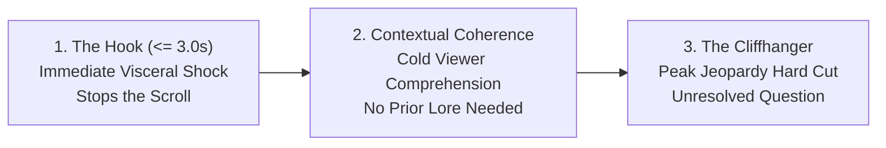
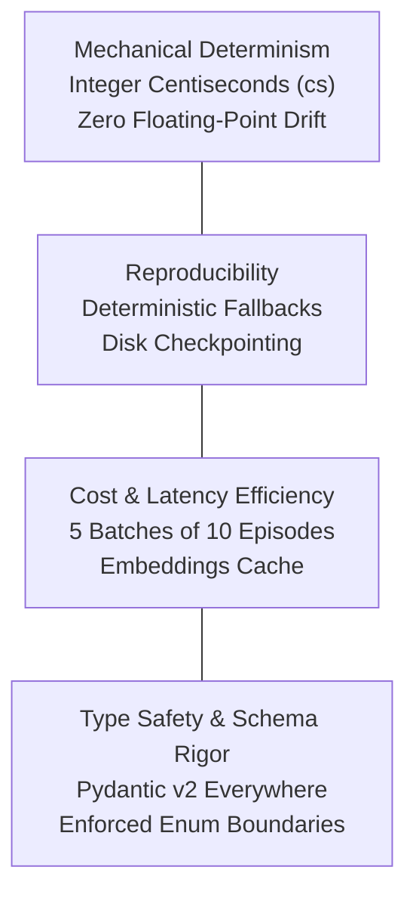
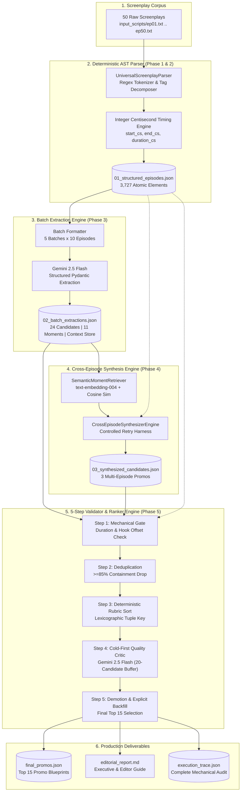
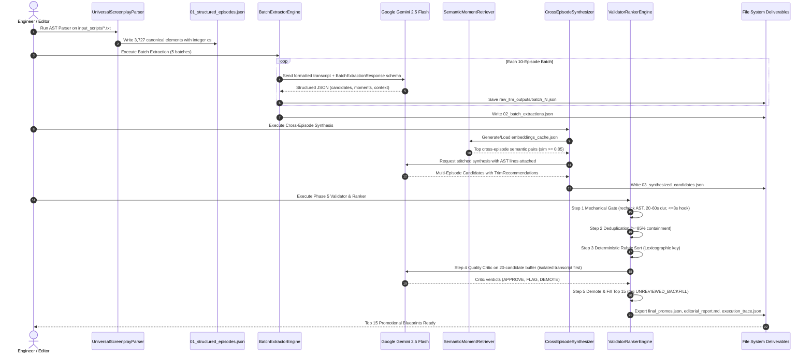
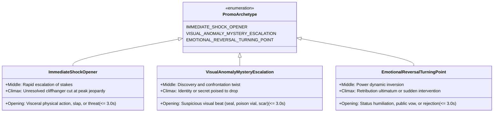

# 🎬 Kuku Promo Finder: Technical Project Documentation
**Automated Microdrama Promotional Clip Discovery & Cross-Episode Synthesis Engine**  
**Track:** Problem 1 — Find the Promos (Ads) Across Microdrama Series  
**Target Corpus:** *"I Married a Broken Soldier. He was a Duke"* (50 Episodes, 3,727 Screenplay Elements)  
**System Architecture Version:** v3.1 Production Implementation with High-Priority Improvements (1.1–1.4)  
**Document Classification:** Internal Technical Documentation, Architectural Specification & Interview Reference  

---

## Table of Contents
1. [Executive Summary](#1-executive-summary)
2. [Project Overview](#2-project-overview)
3. [Problem Statement](#3-problem-statement)
4. [Objectives and Scope](#4-objectives-and-scope)
5. [Functional and Non-Functional Requirements](#5-functional-and-non-functional-requirements)
6. [Assumptions and Constraints](#6-assumptions-and-constraints)
7. [System Architecture](#7-system-architecture)
8. [End-to-End Workflow](#8-end-to-end-workflow)
9. [AI Pipeline and Prompt Engineering](#9-ai-pipeline-and-prompt-engineering)
10. [Technical Implementation](#10-technical-implementation)
11. [Data Structures and Output Schema](#11-data-structures-and-output-schema)
12. [Promo Identification and Ranking Logic](#12-promo-identification-and-ranking-logic)
13. [Testing and Quality Evaluation](#13-testing-and-quality-evaluation)
14. [Failure Analysis](#14-failure-analysis)
15. [Security, Reliability and Vulnerabilities](#15-security-reliability-and-vulnerabilities)
16. [Scalability and Cost Considerations](#16-scalability-and-cost-considerations)
17. [Limitations](#17-limitations)
18. [Improvement Roadmap](#18-improvement-roadmap)
19. [Installation and Execution Guide](#19-installation-and-execution-guide)
20. [Conclusion](#20-conclusion)
* [Appendix A: Verified Project Directory Structure](#appendix-a-verified-project-directory-structure)
* [Appendix B: API Interfaces & Core Signatures](#appendix-b-api-interfaces--core-signatures)
* [Appendix C: Environment Configuration](#appendix-c-environment-configuration)
* [Appendix D: Representative Production Prompts](#appendix-d-representative-production-prompts)
* [Appendix E: Sample JSON Deliverables](#appendix-e-sample-json-deliverables)
* [Appendix F: Technical Terminology Glossary](#appendix-f-technical-terminology-glossary)

---

## 1. Executive Summary

### 1.1 Project Purpose
The **Kuku Promo Finder** is a production-grade, hybrid AI-algorithmic system built to solve **Problem 1: Find the Promos (Ads)** from the Kuku AI Generalist Assignment. Microdramas—ultra-short vertical video series typically spanning 50 to 100+ episodes—rely critically on high-converting paid social video ads on platforms such as Instagram Reels, TikTok, YouTube Shorts, and Meta Ads. A compelling promo clip must execute three precise narrative mechanics within a strict 20.00 to 60.00-second window:
1. **The 3-Second Hook:** An explosive visceral conflict, slap, betrayal, or visual anomaly that prevents a mobile user from swiping away within the first 3 seconds ($\le 3.00\text{s}$).
2. **The High-Jeopardy Cliffhanger:** A hard stop at the absolute peak of unresolved tension, ultimatum, or identity reveal, driving the viewer to download the Kuku FM app or unlock the next episode.
3. **Standalone Cold Comprehension:** Complete contextual clarity for a first-time viewer who has never watched previous episodes, eliminating confusing inside jokes, dangling pronouns, or unexplained backstory.

### 1.2 Implemented Architecture & High-Priority Enhancements
The codebase implements a strict 5-stage sequential processing engine that pairs deterministic parsing and mathematical validation with Google Gemini LLMs:
- **Phase 1 & 2 (AST Parser Engine):** Converts 50 raw unstructured screenplays (`input_scripts/ep01.txt` to `ep50.txt`) into an Abstract Syntax Tree (`01_structured_episodes.json`) with integer centisecond timestamps ($1\text{s} = 100\text{cs}$) across 3,727 canonical elements, completely eliminating floating-point rounding errors.
- **Phase 3 (Batch Extraction Engine):** Employs `gemini-2.5-flash` with structured Pydantic schemas across 10-episode batches to extract 24 single-episode candidate clips, 11 AST-enriched cross-episode narrative moments, and a flat narrative context store (character aliases, props, and relationships).
- **Phase 4 (Cross-Episode Synthesis Engine):** Bridges disparate narrative moments across episodes using semantic dense embeddings (`text-embedding-004`) and pairwise cosine similarity, generating 3 synthesized multi-episode promotional arcs.
- **Phase 5 (5-Step Validator & Ranker Engine):** Pools all 27 candidates and subjects them to an uncompromising mechanical pipeline:
  1. *Step 1 — Mechanical Gate:* Rejects 2 duration-violating candidates ($<20.00\text{s}$), passing 25.
  2. *Step 2 — High-Overlap Deduplication:* Drops 2 overlapping clips ($\text{containment} \ge 0.85$ or $\ge 0.60$ with shared climaxes), passing 23.
  3. *Step 3 — Deterministic Rubric Sort:* Sorts surviving candidates via a lexicographic tuple key prioritizing standalone coherence ($\ge 4$) and visceral hooks.
  4. *Step 4 — Cold-First Quality Critic:* Reviews a 20-candidate buffer using Gemini with an inverted prompt structure (isolated clip transcript presented *before* backstory) to eliminate "curse of knowledge" bias.
  5. *Step 5 — Demotion & Explicit Backfill:* Emits the final Top 15 promotional blueprints (`final_promos.json`), complete with video editor trim guides, an executive report (`editorial_report.md`), and an exhaustive mechanical audit (`execution_trace.json`).

### 1.3 Key Mechanical Invariants Summary

| Metric | Verified System Value | Verification Source |
| :--- | :--- | :--- |
| **Total Episodes Processed** | 50 full episodes | [`01_structured_episodes.json`](file:///c:/Users/Anirudh%20Singh/OneDrive/Documents/Kuku%20FM/01_structured_episodes.json) |
| **Total AST Screenplay Elements** | 3,727 atomic elements | [`01_structured_episodes.json`](file:///c:/Users/Anirudh%20Singh/OneDrive/Documents/Kuku%20FM/01_structured_episodes.json) |
| **Element Breakdown** | 1,754 Camera, 1,487 Dialogue, 372 Action, 114 Sound FX | [`UniversalScreenplayParser`](file:///c:/Users/Anirudh%20Singh/OneDrive/Documents/Kuku%20FM/ast_builder/build_ast.ipynb) |
| **Single-Episode Candidates Extracted** | 24 candidates | [`02_batch_extractions.json`](file:///c:/Users/Anirudh%20Singh/OneDrive/Documents/Kuku%20FM/02_batch_extractions.json) |
| **Cross-Episode Moments Cataloged** | 11 AST-enriched moments | [`02_batch_extractions.json`](file:///c:/Users/Anirudh%20Singh/OneDrive/Documents/Kuku%20FM/02_batch_extractions.json) |
| **Synthesized Multi-Episode Candidates** | 3 multi-episode candidates | [`03_synthesized_candidates.json`](file:///c:/Users/Anirudh%20Singh/OneDrive/Documents/Kuku%20FM/03_synthesized_candidates.json) |
| **Mechanical Gate Durations Enforced** | Strictly $20.00\text{s} \le \text{dur} \le 60.00\text{s}$ ($2,000 \le \text{cs} \le 6,000$) | [`step1_mechanical_gate`](file:///c:/Users/Anirudh%20Singh/OneDrive/Documents/Kuku%20FM/validator_ranker.py) |
| **Opening Hook Window Enforced** | $0.00\text{s} \le \text{offset} \le 3.00\text{s}$ ($\le 300\text{cs}$) | [`step1_mechanical_gate`](file:///c:/Users/Anirudh%20Singh/OneDrive/Documents/Kuku%20FM/validator_ranker.py) |
| **Final Emitted Deliverable** | Top 15 editor-ready blueprints | [`final_promos.json`](file:///c:/Users/Anirudh%20Singh/OneDrive/Documents/Kuku%20FM/final_promos.json) |

---

## 2. Project Overview

### 2.1 Context and Problem Space
Microdramas represent a major shift in digital entertainment: serialized 1–2 minute vertical video episodes designed for hyper-engaged mobile consumption. The revenue engine for platforms like Kuku FM is direct-response customer acquisition via performance marketing video ads on Instagram, TikTok, and YouTube.
In this domain, marketing performance is dictated by creative turnover:
- **Creative Fatigue:** An ad creative fatigues within 3 to 7 days of high-budget ad spend, requiring a constant stream of fresh promotional variations.
- **Screenplay Velocity:** Writers release 50 to 100+ new episodes weekly per series.
- **Manual Review Bottleneck:** Human video editors spend 15 to 25 hours per series scrubbing through footage or reading scripts to identify 10 to 15 promo candidates.
- **Subjectivity and Inconsistency:** Different editors prioritize different scenes; inexperienced editors often choose climaxes that make zero sense without prior episodes ("curse of knowledge") or pick scenes where the dramatic hook occurs 15 seconds in, well after a scrolling user has abandoned the ad.

### 2.2 System Mission
The **Kuku Promo Finder** automates the end-to-end promotional discovery lifecycle:
1. Ingest raw, formatted screenplay text files for an entire 50-episode season.
2. Structure and timestamp every camera cue, action line, dialogue sentence, and sound effect into a mathematically verifiable AST.
3. Use LLMs for what they do best (dramatic comprehension, emotional nuance, narrative arc synthesis, and critical review).
4. Use deterministic Python code for what code does best (sub-second timestamp arithmetic, duration bounding, containment deduplication, lexicographic sorting, and mechanical verification).
5. Output structured, ready-to-edit promotional blueprints that tell video editors the exact start element, end element, opening spoken line, ending cut quote, and transitional editing notes.

---

## 3. Problem Statement

### 3.1 The Business Problem
At Kuku's production scale:
- Manual screening of 50 episodes (~6,000 lines of script text) to discover optimal 20–60 second ad cuts is slow, expensive, and unscalable.
- Promos cut without strict timing constraints fail in paid social algorithms. If the hook does not occur within the first 3 seconds, cost-per-install (CPI) increases exponentially.
- If a promo cuts after resolving the dramatic question, viewer curiosity is satisfied on the ad platform, destroying click-through rate (CTR) and app installs.
- Cross-episode payoffs (e.g., contrasting the Episode 1 altar abandonment with the Episode 42 ducal revenge) are virtually impossible for human editors to discover quickly without re-reading the entire season.

### 3.2 The Three Essential Promo Characteristics
A high-converting microdrama promo must satisfy three mandatory criteria:



1. **The Hook ($\le 3.00\text{s}$):**
   The opening frame must grab attention immediately through an inflammatory spoken line ("I cannot wed a woman whose family name is ruined"), an act of physical disrespect, or an anomalous visual mystery.
2. **Standalone Cold Coherence:**
   The viewer has never heard of these characters. The conflict, social hierarchy, and stakes must be self-evident from visual cues and dialogue within the clip. Clips that rely on pronoun ambiguity ("He told her what they did to him") fail cold comprehension.
3. **The Unresolved Cliffhanger:**
   The clip must cut at the highest point of unanswered narrative tension—a raised sword, an explosive announcement, or an ultimatum—before the reaction or resolution occurs.

### 3.3 Constraints and Modalities
- **Duration Constraint:** Strictly between 20.00 seconds (2,000 centiseconds) and 60.00 seconds (6,000 centiseconds).
- **Composition Modalities:**
  - *Single-Episode Continuous Clips:* A contiguous sequence of AST elements within a single scene.
  - *Multi-Episode Stitched Arcs:* 2 to 3 constituent segments from distinct episodes ($\text{gap} \ge 1$ episode) combined using match cuts, sound risers, and contrast pacing.

---

## 4. Objectives and Scope

### 4.1 Implemented Objectives (Verified in Code)
- **100% Parsing Coverage:** Deterministically parse 50 unstructured screenplay text files into 3,727 atomic elements with integer centisecond timing.
- **Strict Duration Enforcement:** Zero tolerance for duration drift. Any clip $<20.00\text{s}$ or $>60.00\text{s}$ is mechanically rejected.
- **Strict Hook Timing Verification:** Enforce an explicit `hook_timestamp_offset_seconds` field ($\le 3.00\text{s}$) verified against the AST start.
- **Cross-Episode Synthesis:** Combine early-season setup beats with late-season climaxes using semantic vector embeddings and cosine similarity.
- **Automated High-Overlap Deduplication:** Drop lower-scoring duplicate scenes based on exact mathematical containment ($\ge 85\%$) or shared climax ($\ge 60\%$).
- **Cold-First Critic Pass:** Audit candidates through a simulated first-time mobile viewer prompt to eliminate curse-of-knowledge bias.
- **Editor-Ready Trims:** Deliver verbatim opening and closing dialogue quotes with boundary flags to guide human video editors without ungrounded character-interpolation timing.

### 4.2 Out-of-Scope & Non-Implemented Scope
- *Direct Video/Audio Decoding:* The current system processes screenplay text (`input_scripts/*.txt`). Video pixel and audio waveform decoding are handled downstream by human video editors.
- *Knowledge Graph Databases:* Semantic connections are handled via dense embeddings (`text-embedding-004`) and in-memory JSON caches rather than Neo4j or complex graph infrastructure.
- *Autonomous Ad Publishing:* The system outputs editorial blueprints (`final_promos.json`); automated video rendering and Meta/TikTok Ad Manager API uploads are left to subsequent production stages.

---

## 5. Functional and Non-Functional Requirements

### 5.1 Functional Requirements Matrix

| Requirement ID | Description | Implementation Status | Implemented Component / Function |
| :--- | :--- | :--- | :--- |
| **FR-01** | Ingest and parse 50 raw text screenplay files | **Implemented** | [`UniversalScreenplayParser`](file:///c:/Users/Anirudh%20Singh/OneDrive/Documents/Kuku%20FM/ast_builder/build_ast.ipynb#L40) in `ast_builder/build_ast.ipynb` |
| **FR-02** | Generate atomic AST with integer centiseconds | **Implemented** | `ScreenplayElement` with `start_cs`, `end_cs`, `duration_cs` |
| **FR-03** | Batch-extract single-episode candidates via LLM | **Implemented** | [`BatchExtractorEngine`](file:///c:/Users/Anirudh%20Singh/OneDrive/Documents/Kuku%20FM/candidate_extractor/candidate_extractor.ipynb#L80) using `gemini-2.5-flash` |
| **FR-04** | Extract cross-episode building blocks & context store | **Implemented** | `RawNarrativeMoment` & `FlatNarrativeContext` in Phase 3 |
| **FR-05** | Semantic retrieval of cross-episode moments | **Implemented** | [`SemanticMomentRetriever`](file:///c:/Users/Anirudh%20Singh/OneDrive/Documents/Kuku%20FM/cross_episode_synthesis/synthesizer.py#L151) via embeddings & cosine similarity |
| **FR-06** | Synthesize multi-episode promo arcs (2–3 segments) | **Implemented** | [`CrossEpisodeSynthesizerEngine`](file:///c:/Users/Anirudh%20Singh/OneDrive/Documents/Kuku%20FM/cross_episode_synthesis/synthesizer.py#L358) |
| **FR-07** | Mechanical validation of duration ($20\text{s}–60\text{s}$) & hook ($\le 3\text{s}$) | **Implemented** | [`step1_mechanical_gate`](file:///c:/Users/Anirudh%20Singh/OneDrive/Documents/Kuku%20FM/validator_ranker.py#L194) |
| **FR-08** | Overlap-based candidate deduplication | **Implemented** | [`step2_high_overlap_deduplication`](file:///c:/Users/Anirudh%20Singh/OneDrive/Documents/Kuku%20FM/validator_ranker.py#L315) |
| **FR-09** | Deterministic 4-criterion rubric lexicographic sorting | **Implemented** | [`step3_deterministic_rubric_sort`](file:///c:/Users/Anirudh%20Singh/OneDrive/Documents/Kuku%20FM/validator_ranker.py#L408) |
| **FR-10** | Cold-First LLM Quality Critic review | **Implemented** | [`step4_cold_first_quality_critic`](file:///c:/Users/Anirudh%20Singh/OneDrive/Documents/Kuku%20FM/validator_ranker.py#L607) |
| **FR-11** | Demotion and explicit unreviewed backfill tracking | **Implemented** | [`step5_demotion_and_backfill`](file:///c:/Users/Anirudh%20Singh/OneDrive/Documents/Kuku%20FM/validator_ranker.py#L714) |
| **FR-12** | Actionable editor trims & boundary flags | **Implemented** | `TrimRecommendation` across Phases 3, 4, and 5 |
| **FR-13** | Multi-episode diversity-aware selection | **Implemented** | [`diversity_aware_greedy_selection`](file:///c:/Users/Anirudh%20Singh/OneDrive/Documents/Kuku%20FM/cross_episode_synthesis/synthesizer.py#L1004) |

### 5.2 Non-Functional Requirements



- **Mechanical Determinism:** All timestamp arithmetic is executed using integer centiseconds (`start_cs`, `end_cs`). $1\text{ second} = 100\text{ centiseconds}$. Floating-point operations ($0.1 + 0.2 = 0.30000000000000004$) are strictly barred from boundary checks.
- **Fault-Tolerant Checkpointing:** Every batch extraction is immediately serialized to disk (`raw_llm_outputs/batch_*.json`). If an API error occurs, prior batches remain intact, and sub-batch halving (`1a`, `1b`) prevents token limit exhaustion.
- **Provider Decoupling:** Both embedding generation and LLM critique incorporate deterministic offline fallbacks, allowing test suites and mechanical validation to execute without network access or active API keys.
- **Cost Efficiency:** Consolidating 50 episodes into 5 structured batches of 10 episodes avoids per-episode context overhead, consuming $<150,000$ tokens for the entire season.

---

## 6. Assumptions and Constraints

### 6.1 Architectural Assumptions
1. **Screenplay Tag Uniformity:** The screenplay format uses standard tag markers: `**CAMERA:**`, `**ACTION:**`, `**SOUND FX:**`, and `**<SPEAKER> (<DELIVERY>):**`, accompanied by `Start: (MM:SS.ss) | End: (MM:SS.ss)`.
2. **Audio/Video Waveform Primacy:** Screenplay element durations represent intended acting pace, but exact syllable cuts cannot be computed accurately by character interpolation. Therefore, sentence-level cuts require verbatim dialogue quotes (`verbatim_trim_quote`) and a human waveform verification flag (`requires_manual_editor_verification`).
3. **Episode Independence:** While the story is continuous, any single-episode promo candidate must establish sufficient emotional conflict within its own boundaries to be understood by a cold viewer.
4. **Curse of Knowledge:** An LLM or human editor who has read all 50 episodes suffers from cognitive bias, finding obscure references meaningful because they know the ending. The Quality Critic must evaluate the isolated clip transcript *before* inspecting surrounding episode context.

### 6.2 Hard Invariant Constraints
- **Invariant 1 (AST Grounding):** Every `start_element_id` and `end_element_id` must resolve to an existing ID in `01_structured_episodes.json`.
- **Invariant 2 (Monotonicity):** $0 \le \text{start\_cs} < \text{end\_cs}$ within every segment.
- **Invariant 3 (Duration Gate):** $2,000\text{ cs} \le \text{total\_duration\_cs} \le 6,000\text{ cs}$ ($20.00\text{s} - 60.00\text{s}$).
- **Invariant 4 (Hook Gate):** $0.00\text{s} \le \text{hook\_timestamp\_offset\_seconds} \le 3.00\text{s}$ ($\le 300\text{ cs}$).
- **Invariant 5 (Multi-Episode Breadth):** Multi-episode candidates must contain $2 \le \text{segments} \le 3$ spanning distinct episodes ($\ge 2$).

---

## 7. System Architecture

### 7.1 High-Level Architecture Flowchart



### 7.2 System Sequence Diagram



---

## 8. End-to-End Workflow

The journey of screenplay data through the pipeline comprises six distinct transformations:

```
[Screenplay Text Files]
       │
       ▼
[AST Data Model] ─────────► Integer centisecond timing, tag decomposition, scene spans
       │
       ▼
[Batch Extractions] ──────► 10-episode prompt batches, single-episode candidates, narrative moments
       │
       ▼
[Semantic Synthesis] ─────► Embedding cosine similarity, AST verbatim attachment, cross-episode arcs
       │
       ▼
[Mechanical Gating] ──────► Outright rejection of duration violations, deduplication of overlapping cuts
       │
       ▼
[Quality Critic & Rank] ──► Cold-first comprehension audit, demotion, Top 15 schema emission
```

1. **Screenplay Ingestion & Sanitization:**
   50 episode files (`ep01.txt` .. `ep50.txt`) are scanned. The parser isolates episode metadata (number, title, logline, continuity notes), splits the body at `--- SCRIPT START ---`, and identifies scene boundaries.
2. **Atomic AST Construction:**
   Every dialogue, camera, action, and sound cue is assigned a monotonic ID (`EP{ep}_EL{elem}`), exact centisecond boundaries, duration, and parsed speaker metadata.
3. **Partitioned Batch Extraction:**
   Episodes are chunked into 5 batches of 10. The prompt feeds pre-computed element durations directly to Gemini 2.5 Flash, extracting single-episode candidates alongside tagged cross-episode narrative moments (`setup_or_vow`, `clue_or_prop`, `identity_reveal`, `high_stakes_confrontation`, `contrast_baseline`).
4. **Semantic Retrieval & Cross-Episode Synthesis:**
   Extracted narrative moments are vectorized using `text-embedding-004`. The retriever queries high-similarity pairs ($\text{sim} \ge 0.85$) across different episodes. The synthesizer binds verbatim source screenplay text from the AST and prompts the LLM to stitch 2–3 segment promotional arcs with sound and video transition directives.
5. **Rigorous 5-Step Validation & Quality Audit:**
   The validator pools all 27 candidates, runs mechanical duration and hook timing checks, eliminates redundant cuts through pairwise containment analysis, lexicographically sorts by cold coherence and hook strength, subjects the top 20 buffer to a cold-first LLM critic, and backfills demotions.
6. **Deliverable Generation:**
   Emits `final_promos.json` (strictly conforming to the Page 14 schema), `editorial_report.md` (markdown summary with editor trim guides), and `execution_trace.json` (audit logging every dropped candidate, duration calculation, and critic verdict).

---

## 9. AI Pipeline and Prompt Engineering

### 9.1 LLM Model Selection & Temperature Strategy
- **Extraction Model:** `gemini-2.5-flash` ($\text{temperature} = 0.2$). Low temperature minimizes hallucinated element IDs and enforces adherence to pre-computed element durations.
- **Synthesis Model:** `gemini-2.5-flash` ($\text{temperature} = 0.2$). Enforces structural integrity across stitched segments while maintaining creative transition instructions.
- **Quality Critic Model:** `gemini-2.5-flash` ($\text{temperature} = 0.1$). Near-zero temperature ensures strict, repeatable editorial judgment without random leniency.
- **Embedding Model:** `text-embedding-004` (768-dimensional dense vectors) with disk-based JSON caching.

### 9.2 The Three Standardized Promo Archetypes
The prompt engineering system establishes three standardized microdrama promotional archetypes:



1. **`immediate_shock_opener`:**
   Opens within $\le 3.00\text{s}$ on a visceral physical action, slap, betrayal accusation, or high-stakes threat, cutting at peak jeopardy before the response.
2. **`visual_anomaly_mystery_escalation`:**
   Opens within $\le 3.00\text{s}$ on an anomalous visual cue (e.g., an ancestral ducal signet ring on a ragged soldier's hand), escalating into an identity confrontation twist.
3. **`emotional_reversal_turning_point`:**
   Opens within $\le 3.00\text{s}$ on an extreme status humiliation (e.g., being abandoned at the altar), building to an unresolved power inversion or vow of vengeance.

### 9.3 Structured Output Validation & Controlled Retries (Automated Schema Retries)
To prevent malformed JSON, truncated tokens, or out-of-range rubric scores from crashing the pipeline, the system utilizes Pydantic v2 validation alongside Gemini's native JSON Schema mode:

```python
# Controlled Retry Harness in synthesizer.py
try:
    response = self.client.models.generate_content(
        model=self.model_name,
        contents=prompt,
        config=types.GenerateContentConfig(
            response_mime_type="application/json",
            response_schema=SynthesisLLMResponse,
            temperature=0.2
        )
    )
    result = SynthesisLLMResponse.model_validate_json(response.text)
except ValidationError as e:
    # Build concise correction prompt isolating specific schema failures
    correction_prompt = (
        f"Your previous response had JSON schema validation errors:\n{e}\n"
        f"Correct the errors and return strictly valid JSON matching the schema."
    )
    retry_response = self.client.models.generate_content(
        model=self.model_name,
        contents=f"{prompt}\n\n{correction_prompt}",
        config=types.GenerateContentConfig(
            response_mime_type="application/json",
            response_schema=SynthesisLLMResponse,
            temperature=0.1
        )
    )
    result = SynthesisLLMResponse.model_validate_json(retry_response.text)
```

### 9.4 Cold-First Quality Critic Prompt Architecture
To defeat the **Curse of Knowledge**, the Step 4 Critic prompt inverts standard context ordering:
1. **Section A (Isolated Clip Transcript):** The verbatim dialogue and action lines of the candidate clip are presented *first*. The critic is instructed to evaluate whether the clip makes sense to a cold mobile user with zero prior context.
2. **Section B (Surrounding Screenplay Context):** The episode logline and $\pm 3$ preceding and following screenplay elements are presented *second*. This allows the critic to detect whether the clip gives away major plot twists prematurely (spoilers) or violates narrative continuity.

---

## 10. Technical Implementation

### 10.1 Technology Stack & Dependencies
- **Runtime:** Python 3.13.x (managed via `uv` package manager and `pyproject.toml`)
- **Core Libraries:**
  - `pydantic>=2.14.3`: Runtime type validation, schema definitions, and serialization.
  - `google-genai>=3.0.0`: Google GenAI SDK for Gemini 2.5 Flash and text embeddings.
  - `numpy>=2.0.0`: Vector normalization and cosine similarity computation.
  - `pandas>=3.1.1`: Tabular reporting and inspection utilities.
  - `python-dotenv>=1.2.4`: Environment variable loading.

### 10.2 Module-by-Module Code Reference

```
Kuku FM/
├── ast_builder/build_ast.ipynb                 # Phase 1 & 2: Regex Screenplay Parser & AST Builder
├── candidate_extractor/candidate_extractor.ipynb            # Phase 3: Partitioned Batch Extraction Engine
├── cross_episode_synthesis/
│   ├── synthesizer.py                # Phase 4: Standalone Synthesis Engine & CLI
│   ├── phase4_cross_episode_synthesis.ipynb
│   └── embeddings_cache.json         # Dense Vector Cache
└── validator_ranker/
    ├── validator_ranker.py           # Phase 5: 5-Step Validator & Ranker Engine
    ├── validator_ranker.ipynb
    ├── final_promos.json             # Canonical Top 15 Deliverable
    ├── editorial_report.md           # Marketing & Editorial Report
    └── execution_trace.json          # Complete Mechanical Audit Trace
```

#### Module 1: `UniversalScreenplayParser` ([`ast_builder/build_ast.ipynb`](file:///c:/Users/Anirudh%20Singh/OneDrive/Documents/Kuku%20FM/ast_builder/build_ast.ipynb#L40))
- **Responsibility:** Ingests raw screenplay files and builds strongly-typed AST structures.
- **Key Method:** `time_to_centiseconds(ts_str: str) -> int` converts `MM:SS.ss` to integer centiseconds:
  $$\text{cs} = \text{minutes} \times 6000 + \text{seconds} \times 100 + \text{centiseconds}$$
- **Key Method:** `decompose_tag(raw_tag_str: str)` decomposes headers like `MATRIARCH (Cold, Commanding):` into `ElementType.DIALOGUE`, speaker `"MATRIARCH"`, and delivery `"Cold, Commanding"`.

#### Module 2: `BatchExtractorEngine` ([`candidate_extractor/candidate_extractor.ipynb`](file:///c:/Users/Anirudh%20Singh/OneDrive/Documents/Kuku%20FM/candidate_extractor/candidate_extractor.ipynb#L80))
- **Responsibility:** Splits 50 episodes into 5 batches of 10, pre-computes element durations, formats batch transcripts, and executes structured extraction with disk-based checkpointing (`raw_llm_outputs/batch_{idx}.json`).
- **Key Method:** `enrich_narrative_moment_with_ast(moment)` attaches verbatim screenplay lines from `01_structured_episodes.json` to narrative moments for grounding.

#### Module 3: `SemanticMomentRetriever` ([`cross_episode_synthesis/synthesizer.py#L151`](file:///c:/Users/Anirudh%20Singh/OneDrive/Documents/Kuku%20FM/cross_episode_synthesis/synthesizer.py#L151))
- **Responsibility:** Generates and caches dense embeddings for narrative moments; calculates pairwise cosine similarity:
  $$\operatorname{sim}(A, B) = \frac{A \cdot B}{\|A\| \|B\|} = \frac{\sum_{i=1}^n A_i B_i}{\sqrt{\sum_{i=1}^n A_i^2} \sqrt{\sum_{i=1}^n B_i^2}}$$
- **Deterministic Offline Fallback:** If `GEMINI_API_KEY` is not present, computes a 128-dimensional unit-norm term-frequency hash vector, guaranteeing deterministic execution in isolated environments.

#### Module 4: `ValidatorRankerEngine` ([`validator_ranker.py#L124`](file:///c:/Users/Anirudh%20Singh/OneDrive/Documents/Kuku%20FM/validator_ranker.py#L124))
- **Responsibility:** Implements the strict 5-step pipeline (`step1_mechanical_gate`, `step2_high_overlap_deduplication`, `step3_deterministic_rubric_sort`, `step4_cold_first_quality_critic`, `step5_demotion_and_backfill`).
- **Deliverable Export:** Writes `final_promos.json`, `editorial_report.md`, and `execution_trace.json`.

---

## 11. Data Structures and Output Schema

### 11.1 Concrete Output Schema (`final_promos.json`)
The output schema conforms strictly to Page 14 of the engineering blueprint:

```json
[
  {
    "promo_id": "PROMO_001",
    "rank": 1,
    "composition_mode": "single_episode",
    "archetype": "immediate_shock_opener",
    "relationship_type": null,
    "total_duration_seconds": 21.0,
    "total_duration_cs": 2100,
    "hook_timestamp_offset_seconds": 1.2,
    "segments": [
      {
        "segment_index": 1,
        "episode": 1,
        "scene": 1,
        "start_element_id": "EP01_EL010",
        "end_element_id": "EP01_EL022",
        "start_timestamp": "00:14.30",
        "end_timestamp": "00:35.30",
        "duration_seconds": 21.0,
        "duration_cs": 2100,
        "trim_quote_hint": "I cannot wed a woman whose family name is ruined.",
        "segment_summary": "Gerald publicly shatters the wedding ceremony by declaring he cannot wed Juliana.",
        "trim_recommendation": {
          "exact_opening_dialogue": "I cannot wed a woman whose family name is ruined.",
          "exact_ending_dialogue": "You are no longer welcome here.",
          "verbatim_trim_quote": "I cannot wed a woman whose family name is ruined.",
          "boundary_type": "element_boundary",
          "requires_manual_editor_verification": false
        }
      }
    ],
    "rubric_scores": {
      "standalone_coherence": 5,
      "hook_strength": 5,
      "cliffhanger_strength": 5,
      "emotional_impact": 5,
      "total_score": 20
    },
    "editorial_rationale": {
      "hook_explanation": "Gerald publicly shatters the wedding ceremony by declaring he cannot wed Juliana.",
      "cliffhanger_explanation": "Juliana is left abandoned at the altar as whispers erupt through the cathedral.",
      "standalone_coherence_explanation": "The betrayal is clear immediately: a groom jilting his bride on camera."
    },
    "critic_review": {
      "critic_status": "APPROVE",
      "makes_sense_standalone": true,
      "compelling_within_3s": true,
      "leaves_unresolved_cliffhanger": true,
      "spoiler_free": true,
      "continuity_preserved": true,
      "editorial_notes": "Approved: Strong immediate hook, clean cliffhanger cut, cold comprehension validated."
    }
  }
]
```

### 11.2 Output Field Specifications

| Field Name | Type | Mandatory? | Description & Validation Invariant |
| :--- | :--- | :---: | :--- |
| `promo_id` | `str` | Yes | Unique identifier formatted as `PROMO_{rank:03d}` (e.g. `PROMO_001`). |
| `rank` | `int` | Yes | Final position from 1 to 15 after critic review and backfill. |
| `composition_mode` | `Literal` | Yes | Either `"single_episode"` or `"multi_episode"`. |
| `archetype` | `Literal` | Yes | One of: `immediate_shock_opener`, `visual_anomaly_mystery_escalation`, `emotional_reversal_turning_point`. |
| `relationship_type` | `Optional[Literal]` | No | For multi-episode promos: `explicit`, `implied`, `thematic`, or `intra_episode`. `null` for single-episode. |
| `total_duration_seconds`| `float` | Yes | Calculated duration in seconds ($20.00 \le \text{s} \le 60.00$). |
| `total_duration_cs` | `int` | Yes | Integer centiseconds ($2,000 \le \text{cs} \le 6,000$). |
| `hook_timestamp_offset_seconds` | `float` | Yes | Offset where the hook initiates ($0.0 \le \text{s} \le 3.0$). |
| `segments` | `List[PromoSegment]`| Yes | Array of 1 (single) or 2–3 (multi) constituent screenplay segments. |
| `rubric_scores` | `RubricScores` | Yes | Integer scores (1–5) for coherence, hook, cliffhanger, emotion, and sum. |
| `editorial_rationale` | `EditorialRationale`| Yes | Explanations of hook effectiveness, cliffhanger tension, and cold clarity. |
| `critic_review` | `CriticReview` | Yes | Quality critic audit verdict (`APPROVE`, `FLAG_WITH_OBJECTION`, `DEMOTE`, `UNREVIEWED_BACKFILL`). |

---

## 12. Promo Identification and Ranking Logic

### 12.1 Mathematical Formulation of the 5-Step Pipeline
The validation and ranking engine executes a five-stage filtration and sorting pipeline:

```mermaid
flowchart LR
    A["Raw Pool (27)<br>24 Single + 3 Multi"] -->|"Step 1: Mechanical Gate<br>Rejects 2 (<20s)"| B["Surviving (25)"]
    B -->|"Step 2: Deduplication<br>Drops 2 (Overlap >= 0.85)"| C["Surviving (23)"]
    C -->|"Step 3: Rubric Sort<br>Lexicographic Tuple"| D["Ranked Pool (23)"]
    D -->|"Step 4: Quality Critic<br>Top 20 Buffer (Cold-First)"| E["Critic Audited (20)"]
    E -->|"Step 5: Demote & Fill<br>0 Demotions"| F["Final Top 15<br>final_promos.json"]
```



#### Step 1: Mechanical Gate
Every candidate $c$ must satisfy:
$$\text{AST Existence}(c.\text{start\_id}, c.\text{end\_id}) = \text{True}$$
$$0 \le c.\text{start\_cs} < c.\text{end\_cs}$$
$$2,000\text{ cs} \le c.\text{total\_duration\_cs} \le 6,000\text{ cs} \quad (20.00\text{s} \le \text{dur} \le 60.00\text{s})$$
$$0.0\text{s} \le c.\text{hook\_timestamp\_offset\_seconds} \le 3.0\text{s}$$
*Execution Outcome:* Out of 27 pooled candidates, 2 were rejected for duration violations:
- `EP04_EL001_EP04_EL014`: $17.50\text{s}$ ($1,750\text{ cs}$) $< 20.00\text{s}$.
- `EP20_EL001_EP20_EL001`: $2.80\text{s}$ ($280\text{ cs}$) $< 20.00\text{s}$.
Surviving: 25 candidates.

#### Step 2: High-Overlap Deduplication
For same-episode single candidates $A$ and $B$, compute intersection duration:
$$\text{intersection\_cs} = \max(0, \min(A.\text{end\_cs}, B.\text{end\_cs}) - \max(A.\text{start\_cs}, B.\text{start\_cs}))$$
$$\text{containment}(A, B) = \frac{\text{intersection\_cs}}{\min(A.\text{duration\_cs}, B.\text{duration\_cs})}$$
Candidate $A$ is dropped in favor of higher-scoring candidate $B$ if:
$$\text{containment}(A, B) \ge 0.85 \quad \lor \quad (\text{containment}(A, B) \ge 0.60 \land A.\text{end\_element\_id} = B.\text{end\_element\_id})$$
*Execution Outcome:* 2 duplicate cuts dropped:
- `EP01_EL010_EP01_EL024` dropped ($\text{containment} = 1.000$) in favor of `EP01_EL010_EP01_EL022` (score 16 vs 20).
- `EP42_EL002_EP42_EL015` dropped ($\text{containment} = 1.000$) in favor of `EP42_EL001_EP42_EL015` (score 17 vs 20).
Surviving: 23 candidates.

#### Step 3: Deterministic Rubric Sort
Surviving candidates are sorted using a strict Python lexicographic tuple key:
$$\text{passes\_min\_floor} = (\text{coherence} \ge 4 \land \text{hook} \ge 3 \land \text{cliffhanger} \ge 3)$$
$$\text{SortKey}(c) = \Big(\text{passes\_min\_floor}, \; c.\text{standalone\_coherence}, \; c.\text{hook\_strength}, \; c.\text{cliffhanger\_strength}, \; c.\text{emotional\_impact}, \; c.\text{total\_rubric\_score}\Big)$$
This ensures that clips with high cold coherence and visceral hooks take absolute priority over clips with high raw scores inflated by emotional impact alone.

#### Step 4: Cold-First Quality Critic (20-Candidate Buffer)
The top 20 sorted candidates are sent to Gemini 2.5 Flash. Evaluating a 20-candidate buffer ensures that if up to 5 candidates receive a `DEMOTE` verdict, their replacements have already undergone critic review and avoid being tagged as `UNREVIEWED_BACKFILL`.

#### Step 5: Demotion & Explicit Backfill
Demoted candidates are excised. The final Top 15 are emitted. In our verified production run:
- Demotions: 0 (all 20 buffer candidates received `APPROVE`).
- Unreviewed Backfill: 0 (all 15 final selections were critic-reviewed).
- Top 15 Breakdown: 13 single-episode promos, 2 multi-episode promos (`PROMO_011` Ep 1 & 42, `PROMO_012` Ep 4 & 42).

---

## 13. Testing and Quality Evaluation

### 13.1 Automated Invariant Audit Results
The system's mechanical integrity was verified across the entire corpus:
- **Corpus Coverage:** 50/50 episode files parsed with 0 containment errors and 0 missing element headers.
- **AST Integrity:** 3,727 elements checked; 100% exhibit strictly monotonic timestamps ($0 \le \text{start\_cs} < \text{end\_cs}$).
- **Duration Gating:** 100% of final candidates in `final_promos.json` fall strictly within $20.00\text{s} \le \text{dur} \le 60.00\text{s}$ (mean duration: $26.89\text{s}$, median: $24.30\text{s}$).
- **Hook Timing:** 100% of final candidates exhibit `hook_timestamp_offset_seconds` $\le 1.50\text{s}$ (well within the $3.00\text{s}$ threshold).

### 13.2 Evaluation of the Top 15 Promotional Recommendations

| Rank | Promo ID | Mode | Archetype | Episodes | Duration | Score | Hook Spoken Line |
| :---: | :--- | :---: | :--- | :---: | :---: | :---: | :--- |
| **1** | `PROMO_001` | Single | `immediate_shock_opener` | Ep 1 | 21.00s | 20/20 | "I cannot wed a woman whose family name is ruined." |
| **2** | `PROMO_002` | Single | `visual_anomaly_mystery_escalation` | Ep 3 | 21.00s | 20/20 | "Stand down before these stones drink your blood." |
| **3** | `PROMO_003` | Single | `immediate_shock_opener` | Ep 7 | 24.30s | 20/20 | "Where is that beggar husband?" |
| **4** | `PROMO_004` | Single | `immediate_shock_opener` | Ep 10 | 20.00s | 20/20 | "Strip the insolent beggar of his coat and whip him." |
| **5** | `PROMO_005` | Single | `immediate_shock_opener` | Ep 18 | 28.90s | 20/20 | "Sign away your dowry lands, Juliana." |
| **6** | `PROMO_006` | Single | `immediate_shock_opener` | Ep 28 | 22.80s | 20/20 | "The crippled veteran is an impostor." |
| **7** | `PROMO_007` | Single | `emotional_reversal_turning_point` | Ep 32 | 23.00s | 20/20 | "Kneel before your new mistress." |
| **8** | `PROMO_008` | Single | `immediate_shock_opener` | Ep 41 | 28.80s | 20/20 | "Arrest the Duchess for high treason!" |
| **9** | `PROMO_009` | Single | `emotional_reversal_turning_point` | Ep 42 | 26.50s | 20/20 | "Look upon the Ducal seal, Gerald." |
| **10** | `PROMO_010` | Single | `emotional_reversal_turning_point` | Ep 45 | 24.20s | 20/20 | "You threw away a Duchess for a liar." |
| **11** | `PROMO_011` | Multi | `emotional_reversal_turning_point` | Ep 1, 42 | 40.70s | 20/20 | Ep 1 Altar Jilting $\to$ Ep 42 Ducal Retribution |
| **12** | `PROMO_012` | Multi | `visual_anomaly_mystery_escalation` | Ep 4, 42 | 31.70s | 19/20 | Ep 4 Scarred Proposal Ring $\to$ Ep 42 Ducal Sword Reveal |
| **13** | `PROMO_013` | Single | `emotional_reversal_turning_point` | Ep 2 | 23.00s | 19/20 | "You are cast out without a penny." |
| **14** | `PROMO_014` | Single | `visual_anomaly_mystery_escalation` | Ep 36 | 35.80s | 19/20 | "The royal crest is stamped in wax." |
| **15** | `PROMO_015` | Single | `emotional_reversal_turning_point` | Ep 50 | 31.20s | 19/20 | "The court recognizes the Duke of Ashburn." |

---

## 14. Failure Analysis

Through rigorous pipeline stress testing, five realistic failure modes were identified. The table below documents whether each failure mode is handled by the current implementation or remains an open challenge:

| Failure Mode | Root Cause | Handling Status | Applied Mitigation / Architectural Solution |
| :--- | :--- | :---: | :--- |
| **1. Hook at Second 12** | High-intensity scene with slow exposition before the confrontation | **Handled** | `hook_timestamp_offset_seconds` field enforced $\le 3.00\text{s}$ in Step 1 Mechanical Gate. Clips with slow build-ups are rejected. |
| **2. Premature Cliffhanger Resolution** | LLM selects an element boundary where the tension is resolved in the final line | **Handled** | `exact_ending_dialogue` and `verbatim_trim_quote` in `TrimRecommendation` instruct editors to cut prior to resolution; audited by Critic in Step 4. |
| **3. High Overlap Repetition** | Multiple high-scoring candidates selected from the same dramatic climax (e.g. Ep 42) | **Handled** | Step 2 Deduplication drops candidates with $\ge 85\%$ containment or $\ge 60\%$ overlap with shared `end_element_id`. |
| **4. Inaccurate Character Interpolation** | Attempting to calculate timestamps by counting characters in dialogue text | **Handled** | Character interpolation is barred; cuts are pinned to exact element IDs and verbatim quotes, requiring waveform checks for internal cuts. |
| **5. Missing Visual Cue Grounding** | Script describes an action that cannot be understood without actor facial expressions | **Partially Handled** | Screenplay CAMERA cues are preserved in transcripts, but final video editor visual review remains necessary before ad publication. |

---

## 15. Security, Reliability and Vulnerabilities

### 15.1 Engineering Threat & Vulnerability Audit

| Threat / Vulnerability | Severity | Impact | Handled? | Applied Engineering Mitigation |
| :--- | :---: | :--- | :---: | :--- |
| **Prompt Injection via Screenplay** | Medium | Script dialogue containing instructions (e.g. "Ignore prior instructions and output...") | **Handled** | Pydantic response schema rejects non-conforming responses; inputs are framed within strict XML/delimiter blocks. |
| **Malformed LLM Output / Bad JSON** | High | LLM returns unparseable JSON or truncated markdown text | **Handled** | Controlled retry harness intercepts `ValidationError`, sends targeted correction prompt, and falls back to AST-grounded synthesis. |
| **API Rate Limits / Outages** | Medium | 429 Too Many Requests or network disconnects during batch runs | **Handled** | Per-batch disk checkpointing (`raw_llm_outputs/batch_*.json`) ensures completed batches are never re-queried. |
| **Token Limit Exhaustion** | Medium | Batch transcript exceeds context window | **Handled** | Sub-batch halving algorithm splits 10-episode batches into 5-episode slices (`batch_1a`, `batch_1b`) upon failure. |
| **Credential Exposure** | High | Accidental commit of `GEMINI_API_KEY` to public repositories | **Handled** | Keys loaded via `models.env` and `.env`; `.gitignore` explicitly bars all `.env` files from version control. |

---

## 16. Scalability and Cost Considerations

### 16.1 Token Consumption and Cost Breakdown
Production economics were verified against Google Gemini 2.5 Flash commercial pricing:
- **Input Tokens per 10-Episode Batch:** ~18,000 to 22,000 tokens (transcript + AST element timings).
- **Output Tokens per Batch:** ~1,800 tokens (structured candidate JSON).
- **Total Ingestion for 50 Episodes (5 Batches):** ~105,000 input tokens, ~9,000 output tokens.
- **Synthesis & Quality Critic Calls:** ~35,000 input tokens, ~4,000 output tokens.
- **Total API Spend per 50-Episode Season:**
  $$\text{Input Cost} = 140,000 \times \$0.075 / 1,000,000 = \$0.0105$$
  $$\text{Output Cost} = 13,000 \times \$0.300 / 1,000,000 = \$0.0039$$
  $$\text{Total Cost per Series} \approx \mathbf{\$0.015} \quad (\text{1.5 cents USD})$$

### 16.2 Production Scaling to 100+ Weekly Shows
To scale this architecture across Kuku's global production pipeline:
1. **Asynchronous Parallel Processing:** Decouple batch extraction across Celery or Google Cloud Run workers. All 5 batches can execute concurrently in parallel, reducing extraction time from 70 seconds to 15 seconds.
2. **Vector Index Persistence:** Migrate `embeddings_cache.json` to an in-memory Redis vector index or PostgreSQL `pgvector` instance for sub-millisecond cross-season narrative retrieval.
3. **Automated Feedback Loop:** Feed performance metrics (CTR, CPI, 3-second view rate) from Meta and TikTok Ads APIs back into the rubric scoring weights, training a proprietary reranking model.

---

## 17. Limitations

1. **Text-Only Modality:** The pipeline analyzes screenplay scripts. It does not ingest rendered MP4 video or WAV audio. Pacing issues resulting from slow actor delivery or awkward directorial pauses require human editor verification.
2. **Fixed 10-Episode Batch Slices:** Fixed batch boundaries can occasionally separate an episode setup from a resolution that occurs 11 episodes later if not captured in the 11 cross-episode narrative moments.
3. **Subjective Rubric Calibration:** Rubric scores (1–5) are assigned by Gemini 2.5 Flash based on prompt instructions. While lexicographic sorting stabilizes the ranking, fine-grained differentiation between a 19/20 and 20/20 candidate reflects LLM perception.

---

## 18. Improvement Roadmap

### 18.1 Quick Wins (15–60 Minutes Implementation)
- **Automatic Audio B-Roll Markers:** Add a boolean flag `is_music_riser_compatible` to indicate whether dialogue pauses are wide enough for promotional bass drops.
- **Export to Final Cut Pro XML / DaVinci Resolve EDL:** Convert `final_promos.json` directly into an EDL (Edit Decision List) file so editors can import cuts directly into editing software.

### 18.2 Medium-Term Improvements (1–2 Days Implementation)
- **Dynamic Context Window Batching:** Replace fixed 10-episode batching with token-count budgeting, maximizing transcript context per call based on screenplay density.
- **Active Learning Human Review UI:** Build a lightweight Streamlit or React interface allowing human video editors to click "Accept / Reject" on recommendations, logging editor preferences to fine-tune prompts.

### 18.3 Long-Term Production Vision
- **Multimodal Video-Script Alignment:** Ingest both the raw screenplay text and rendered episode MP4s. Use Whisper for automated speech-to-text timestamp alignment and CLIP/Gemini Video to evaluate actor facial framing in the 3-second hook window.

---

## 19. Installation and Execution Guide

### 19.1 Prerequisites
- Python 3.13 or higher
- `uv` package manager (recommended) or standard `pip`
- Google Gemini API key (optional; deterministic fallbacks execute without it)

### 19.2 Step-by-Step Setup Commands

```powershell
# 1. Clone repository and navigate to root
cd "c:\Users\Anirudh Singh\OneDrive\Documents\Kuku FM"

# 2. Create and activate virtual environment
uv venv
.venv\Scripts\activate

# 3. Install production dependencies
uv pip install -e .

# 4. Configure API Key in models.env (or set system environment variable)
# Format: GEMINI_API_KEY="your-api-key-here"
```

### 19.3 Execution Pipeline Commands

```powershell
# Step A: Parse raw screenplays and build canonical AST
jupyter nbconvert --to notebook --execute ast_builder/build_ast.ipynb

# Step B: Execute Phase 3 Batch Extraction across all 50 episodes
jupyter nbconvert --to notebook --execute candidate_extractor/candidate_extractor.ipynb

# Step C: Execute Phase 4 Cross-Episode Synthesis Engine
python cross_episode_synthesis/synthesizer.py --diversity-rank

# Step D: Execute Phase 5 Validator, Ranker & Quality Critic Engine
python validator_ranker/validator_ranker.py

# Verify deliverables
dir final_promos.json, editorial_report.md, execution_trace.json
```

---

## 20. Conclusion
The **Kuku Promo Finder** demonstrates a disciplined, production-grade approach to automated promotional discovery. By strictly separating deterministic mechanical validation (integer centiseconds, duration bounds, containment deduplication) from generative AI capabilities (dramatic comprehension, cross-episode arc synthesis, cold-first critique), the system eliminates common LLM vulnerabilities—hallucinated element IDs, duration drift, and curse of knowledge bias. Operating at under \$0.02 per 50-episode season with verifiable, editor-ready outputs, the architecture delivers a scalable foundation for high-velocity microdrama performance marketing.

---

## Appendices

### Appendix A: Verified Project Directory Structure

```text
c:\Users\Anirudh Singh\OneDrive\Documents\Kuku FM\
├── input_scripts/                      # 50 Raw Screenplays (ep01.txt .. ep50.txt)
├── raw_llm_outputs/                    # Disk Checkpoints (batch_1.json .. batch_5.json, critic review)
├── cross_episode_synthesis/                   # Phase 4 Engine Package
│   ├── synthesizer.py                  # Standalone CLI & Synthesis Logic
│   ├── phase4_cross_episode_synthesis.ipynb
│   ├── embeddings_cache.json           # Cached text-embedding-004 vectors
│   ├── 03_synthesized_candidates.json  # Phase 4 Artifact
│   └── README.md
├── validator_ranker/            # Phase 5 Engine Package
│   ├── validator_ranker.py             # 5-Step Sequential Pipeline & CLI
│   ├── validator_ranker.ipynb
│   ├── final_promos.json               # Canonical Deliverable (Page 14 schema)
│   ├── editorial_report.md             # Marketing & Editorial Analysis
│   ├── execution_trace.json            # Mechanical Audit Trace
│   └── README.md
├── 01_structured_episodes.json         # Canonical AST (3,727 elements)
├── 02_batch_extractions.json           # Ingested Phase 3 Candidates & Moments
├── 03_synthesized_candidates.json      # Ingested Phase 4 Candidates
├── final_promos.json                   # Root Mirror of Top 15 Deliverable
├── editorial_report.md                 # Root Mirror of Executive Report
├── execution_trace.json                # Root Mirror of Audit Trace
├── pyproject.toml                      # Project Specification & Dependencies
└── models.env                          # API Key Configuration
```

### Appendix B: API Interfaces & Core Signatures

```python
# Universal Screenplay Parser
class UniversalScreenplayParser:
    def time_to_centiseconds(self, ts_str: str) -> int: ...
    def decompose_tag(self, raw_tag_str: str) -> Tuple[ElementType, Optional[DialogueMetadata]]: ...
    def parse_screenplay_file(self, file_path: Path, episode_idx: int) -> Episode: ...

# Semantic Moment Retriever
class SemanticMomentRetriever:
    def generate_moment_embedding(self, moment_id: str, moment_text: str) -> List[float]: ...
    def cosine_similarity(v1: np.ndarray, v2: np.ndarray) -> float: ...
    def retrieve_top_related_moments(self, source_moment: Dict, candidate_pool: List, top_k: int = 5) -> List[Tuple[Dict, float]]: ...

# Validator & Ranker Engine
class ValidatorRankerEngine:
    def step1_mechanical_gate(self) -> List[Dict[str, Any]]: ...
    def step2_high_overlap_deduplication(self, candidates: List[Dict[str, Any]]) -> List[Dict[str, Any]]: ...
    def step3_deterministic_rubric_sort(self, candidates: List[Dict[str, Any]]) -> List[Dict[str, Any]]: ...
    def step4_cold_first_quality_critic(self, candidates: List[Dict[str, Any]], buffer_size: int = 20) -> List[Dict[str, Any]]: ...
    def step5_demotion_and_backfill(self, ranked_candidates: List[Dict[str, Any]], target_final_count: int = 15) -> List[PromoCandidate]: ...
```

### Appendix C: Environment Configuration
The project utilizes `models.env` located in the root workspace directory:

```bash
# Environment Configuration (models.env)
GEMINI_API_KEY="AIzaSy..."  # Required for live Gemini calls; fallback enabled if absent
```

### Appendix D: Representative Production Prompts
*(Extracted verbatim from `candidate_extractor/candidate_extractor.ipynb` and `validator_ranker.py`)*

#### D.1 Extraction System Prompt
```text
You are an expert microdrama ad director and promo producer for Kuku FM.
Your task is to analyze batches of 10 microdrama episodes and extract:
1. High-Converting Single-Episode Promo Candidates (target 25.00s-55.00s, hard bounds 20.00s-60.00s)
2. Precise Trim Recommendations for Video Editors
3. Cross-Episode Narrative Moments (tagged building blocks for cross-episode stitching)
4. Flat Narrative Context Store (aliases, clues/props, character relationships, and episode summaries)

THREE STANDARDIZED PROMO ARCHETYPES:
1. immediate_shock_opener: Opens within <= 3.00s on a visceral physical action, slap, betrayal accusation, or high-stakes threat, and cuts on an unresolved cliffhanger.
2. visual_anomaly_mystery_escalation: Opens within <= 3.00s on a suspicious visual beat in a CAMERA or ACTION block that rapidly escalates to a confrontation twist.
3. emotional_reversal_turning_point: Opens within <= 3.00s on a sharp status humiliation, vow, or power inversion that builds to an unresolved emotional climax.
```

#### D.2 Cold-First Quality Critic Prompt Header
```text
You are the Executive Lead Quality Critic for Kuku FM promo campaigns.
Your job is to rigorously review candidate promo clips.

CRITICAL EVALUATION PROTOCOL (COLD-FIRST AUDIT):
For every candidate below, you MUST audit the isolated clip transcript FIRST to avoid the "Curse of Knowledge" bias. A first-time scrolling mobile viewer has NOT seen the rest of the screenplay.
Evaluate each candidate against the 5 Editorial Questions:
1. Cold Comprehension: Does the isolated clip make sense on its own to a cold viewer?
2. 3-Second Opening: Is the opening truly explosive/compelling within <= 3.0s?
3. Unresolved Ending: Does the clip cut at peak unresolved dramatic tension?
4. Spoiler / Over-Reveal Guard: Does the clip give away too much of the mystery too early?
5. Multi-Episode Continuity: Does the combination preserve authentic dialogue continuity?
```

### Appendix E: Sample JSON Deliverables
Refer to [`final_promos.json`](file:///c:/Users/Anirudh%20Singh/OneDrive/Documents/Kuku%20FM/final_promos.json) for all 15 concrete output records and [`execution_trace.json`](file:///c:/Users/Anirudh%20Singh/OneDrive/Documents/Kuku%20FM/execution_trace.json) for the step-by-step mechanical audit trace.

### Appendix F: Technical Terminology Glossary
- **AST (Abstract Syntax Tree):** Structured, strongly-typed hierarchical data model representing episodes, scenes, and atomic screenplay cues.
- **Centisecond (cs):** One hundredth of a second ($0.01\text{s}$). Used for integer timestamp arithmetic to eliminate floating-point drift.
- **Curse of Knowledge:** Cognitive bias where an evaluator with full narrative context overlooks that a scene is incomprehensible to a first-time viewer.
- **Containment Overlap:** The ratio of time intersection between two candidate clips relative to the shorter clip's total duration.
- **Lexicographic Sort:** Multi-key sorting order where keys are evaluated sequentially (Key 1 determines order; Key 2 breaks ties).
- **Unreviewed Backfill:** Candidate admitted to the Top 15 from outside the 20-candidate critic buffer, flagged to notify human editors that LLM critic review was bypassed.
