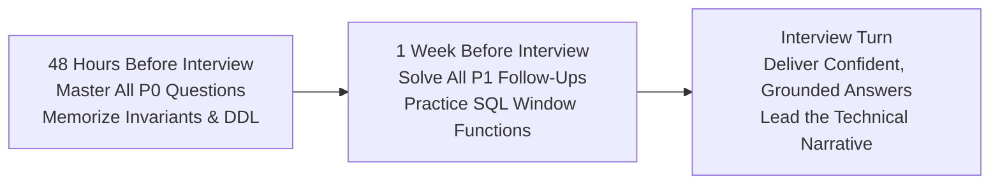

# 🎯 Interview Preparation Priority Matrix
**Target System:** Kuku Promo Finder — Phase 1 (`ast_builder`) Engine  
**Target Roles:** Data Analyst & Applied AI Engineer  
**Purpose:** Tactical preparation hierarchy ranking every question by relevance (P0–P3), difficulty, question type, evidence source, and study priority.

---

## 1. Priority Taxonomy & Evaluation Framework

To maximize interview ROI, questions are categorized across four strict priority tiers:

* **P0 (Critical / Mandatory Defense):** Questions directly attacking core architectural decisions, data integrity choices, or fundamental trade-offs in your code. Failing to answer a P0 question immediately signals a lack of ownership or theoretical depth.
* **P1 (High Probability Follow-Up):** Technical follow-ups probing edge cases, failure modes, data modeling (SQL), or performance optimization.
* **P2 (Supporting Conceptual Breadth):** Adjacent domain questions testing statistical concepts, advanced compiler theory, or broader data engineering best practices.
* **P3 (Edge Case & Advanced Systems):** Specialized, deep-infrastructure, or research-level questions (e.g. AST mutation via NodeTransformer, deep kernel memory profiling).

---

## 2. Master Priority Matrix Table

| Question ID | Question Summary | Target Role | Priority | Difficulty | Question Type | Evidence Source | Preparation Rationale |
| :--- | :--- | :---: | :---: | :---: | :---: | :---: | :--- |
| **Q-AI-01** | *Why build a deterministic Python parser instead of using Gemini/GPT-4 directly?* | AI Engineer | **P0** | Advanced | Architecture & Defense | Reported Industry Question | The #1 question any AI manager will ask. Tests understanding of LLM limits, cost, and determinism. |
| **Q-AI-02** | *Explain 'Symbol Grounding' and how AST IDs prevent LLM hallucinations.* | AI Engineer | **P0** | Advanced | Conceptual & Architecture | Project-Derived Prediction | Connects Phase 1 directly to Phase 3/5 reliability and prompt design. |
| **Q-DA-01** | *Why convert timestamps to integer centiseconds instead of floats?* | Data Analyst | **P0** | Intermediate | Implementation | Project-Derived Prediction | Core data engineering decision preventing IEEE 754 precision drift across filters. |
| **Q-DA-04** | *What is a 'silent data quality failure,' and how does `ValidationAudit` prevent it?* | Data Analyst | **P0** | Advanced | Scenario-Based | Reported Industry Question | Evaluates data pipeline integrity and defensive engineering against corruption. |
| **Q-DA-06** | *Design a normalized PostgreSQL schema (DDL) for episodes, scenes, and elements.* | Data Analyst | **P0** | Intermediate | Architecture & SQL | Reported Industry Question | Tests ability to translate semi-structured JSON AST into enterprise data warehouse models. |
| **Q-DA-07** | *Write SQL window functions (`LAG`, `SUM OVER`) to compute speaker turn pacing.* | Data Analyst | **P0** | Advanced | Coding (SQL) | Reported Industry Question | Essential SQL assessment round benchmark at content-tech startups (Pocket FM, InMobi). |
| **Q-CODE-01**| *Does the `element_pattern` regex risk catastrophic backtracking ($O(2^n)$)?* | Both Roles | **P0** | Advanced | Code Defense | Project-Derived Prediction | Tests computer science rigor, regex automata mechanics, and security against ReDoS. |
| **Q-AI-07** | *Why does word-count pacing heuristic fail, and how would you use Whisper for alignment?* | AI Engineer | **P0** | Advanced | Applied AI & Multimodal | Project-Derived Prediction | Exposes text-vs-video modality gap and presents a production multimodal AI solution. |
| **Q-DA-09** | *Design an A/B test comparing regex parser vs LLM parser on ad CTR and cost.* | Data Analyst | **P0** | Advanced | Experimentation | Reported Industry Question | Demonstrates commercial awareness and statistical experiment design. |
| **Q-AI-03** | *Why is AST-aware semantic chunking superior to fixed-token sliding window chunking?* | AI Engineer | **P0** | Intermediate | System Design | Reported Industry Question | Standard RAG/LLM context design question testing dramatic turn preservation. |
| **Q-DA-02** | *Write a Pandas pipeline to flatten the nested JSON AST into an analytical DataFrame.* | Data Analyst | **P1** | Intermediate | Coding (Python) | Common Industry Question | Practical data manipulation test in Python live coding rounds. |
| **Q-DA-03** | *How do you identify, quantify, and analyze concurrency in screenplay elements?* | Data Analyst | **P1** | Advanced | Debugging & Analytics | Project-Derived Prediction | Probes understanding of simultaneous camera/audio/action tracks vs sequential lines. |
| **Q-DA-05** | *How to detect a 40% dialogue misclassification using Z-scores and Chi-Squared tests?* | Data Analyst | **P1** | Intermediate | Statistical / Quality | Project-Derived Prediction | Evaluates statistical process control and distribution drift monitoring. |
| **Q-AI-04** | *Calculate token savings and TTLT latency reduction from pre-computed AST durations.* | AI Engineer | **P1** | Intermediate | Mathematical / Economics | Project-Derived Prediction | Demonstrates cost-per-series analysis and token optimization skills. |
| **Q-AI-05** | *Edge cases in `decompose_tag` and how to replace heuristic with an NER classifier.* | AI Engineer | **P1** | Advanced | Implementation & NLP | Project-Derived Prediction | Bridges simple string parsing with token-classification models (DistilBERT/SpaCy). |
| **Q-AI-06** | *When do regular expressions break down for hierarchical text (Chomsky Hierarchy)?* | AI Engineer | **P1** | Advanced | Compiler & NLP | Common Industry Question | Tests theoretical computer science knowledge (Type-3 Regular vs Type-2 CFG). |
| **Q-AI-08** | *How to design a primary-secondary-heuristic fallback cascade for parser resilience?* | AI Engineer | **P1** | Intermediate | Reliability | Reported Industry Question | Standard system design question for high-availability production ingestion pipelines. |
| **Q-CODE-02**| *Why did you implement a three-tier fallback search in `discover_screenplay_files`?* | Both Roles | **P1** | Intermediate | Code Defense | Project-Derived Prediction | Explains path resolution and natural numeric sorting (`ep1` vs `ep10`). |
| **Q-DA-08** | *Formulate a mathematical 'Pacing Index' for microdrama dramatic tension.* | Data Analyst | **P1** | Intermediate | Analytical Reasoning | Project-Derived Prediction | Shows product empathy and metric formulation from raw screenplay data. |
| **Q-CODE-03**| *How would you scale `ast_builder` to 25,000 episode scripts per week?* | Both Roles | **P1** | Advanced | Scalability & Systems | Project-Derived Prediction | Tests multiprocessing, streaming I/O, and columnar Parquet optimization. |
| **Q-DA-10** | *How to calculate Inter-Annotator Agreement (Cohen's Kappa) for gold-standard evaluation?* | Data Analyst | **P2** | Intermediate | Statistical | Common Industry Question | Important for establishing ground-truth evaluation datasets. |
| **Q-AI-09** | *How does Python's GIL impact multithreading vs multiprocessing for AST generation?* | AI Engineer | **P2** | Intermediate | Python Systems | Common Industry Question | Explains why regex parsing is CPU-bound and requires multiprocessing. |
| **Q-CODE-04**| *Why use `slots=True` and `frozen=True` in dataclasses instead of standard classes?* | Both Roles | **P2** | Intermediate | Python Internals | Reported Industry Question | Demonstrates memory struct allocation and immutability guarantees. |
| **Q-AI-10** | *How would you fine-tune a small language model (SLM) to reformat broken script tags?* | AI Engineer | **P2** | Advanced | GenAI Fine-Tuning | Common Industry Question | Self-healing pipeline implementation details using LoRA/QLoRA. |
| **Q-CODE-05**| *How does `parse_timestamp_to_cs` round 3-digit milliseconds vs 1-digit tenths?* | Both Roles | **P2** | Beginner | Code Implementation | Project-Derived Prediction | Tests exact knowledge of lines 154–160 in `parser.py`. |
| **Q-AI-11** | *How would you parse an AST using Python's `ast.NodeVisitor` for static code analysis?* | AI Engineer | **P3** | Advanced | Compiler Design | Common Industry Question | Tests general compiler knowledge outside screenplay parsing. |
| **Q-DA-11** | *Explain the mathematical difference between Macro-F1 and Micro-F1 on imbalanced data.* | Data Analyst | **P3** | Intermediate | Mathematical | Common Industry Question | Statistical measurement rigor for rare classes ($3\%$ Sound FX). |

---

## 3. Preparation Strategy: 48-Hour vs. 1-Week Action Plan

### The 48-Hour Sprint (Focus Strictly on P0)
1. **The Core Narrative Defense (Q-AI-01 & Q-AI-02):** Rehearse your answer explaining why you used deterministic Python instead of an LLM. Use the phrase: *"Code is for math, determinism, and immutable symbol grounding; LLMs are for semantic nuance and narrative comprehension."*
2. **Integer Centiseconds Defense (Q-DA-01):** Be ready to explain IEEE 754 floating-point inaccuracies ($0.1 + 0.2 \neq 0.3$) on a whiteboard and write the centisecond conversion formula.
3. **Live SQL Coding (Q-DA-06 & Q-DA-07):** Write out the DDL and window function queries (`LAG() OVER (ORDER BY start_cs)`) without syntax errors.
4. **Validation Audit Defense (Q-DA-04):** Explain how `ValidationAudit` prevents silent data corruption and why you abort execution if timestamp errors occur.

### The 1-Week Deep Dive (Master P1 & P2)
1. **Code Deep Dive:** Read `ast_builder/parser.py` line-by-line using `project_code_deep_dive.md`.
2. **Statistical Rigor:** Review Chi-squared tests, Cohen's Kappa, and Macro-vs-Micro F1 calculations.
3. **Multimodal Alignment:** Be prepared to sketch out the Whisper forced-alignment architecture on a whiteboard.
4. **Scalability Calculations:** Rehearse the memory and multiprocessing calculations for scaling from 50 episodes to 25,000 episodes.
