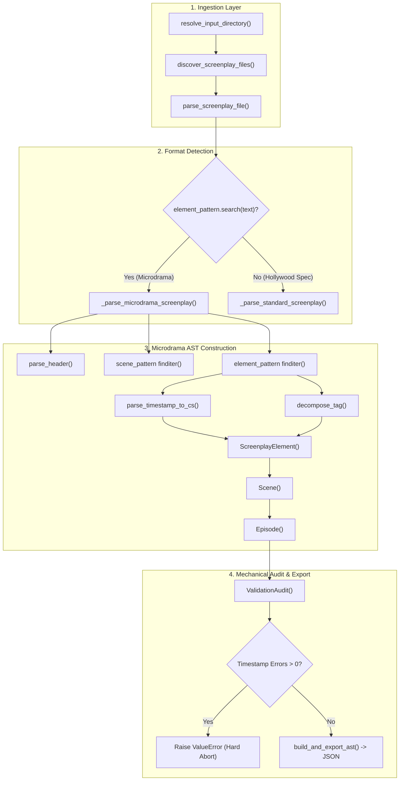

# 🔬 Code Deep-Dive & Technical Defense Guide: `ast_builder`
**Target File:** `ast_builder/parser.py` (and `ast_builder/build_ast.ipynb`)  
**Target Roles:** Senior Technical Interviewer, AI Engineering Hiring Manager, Data Science Lead  
**Document Purpose:** Exhaustive module-level, class-level, and function-level technical autopsy of the Phase 1 codebase. Every function is analyzed across 10 mandatory dimensions: responsibility, inputs/outputs, algorithms, design decisions, potential bugs, edge cases, optimization opportunities, complexity, primary interview questions, and follow-ups.

---

## Section 1: Architectural Blueprint & Module Responsibility

The module `ast_builder/parser.py` is the foundational compiler front-end of the Kuku Promo Finder system. Its sole responsibility is to ingest raw, heterogeneous screenplay text files (microdrama script files with markdown tags or traditional spec scripts in `.txt` or `.pdf` format) and deterministically compile them into an immutable, strongly-typed, mathematically verified **Abstract Syntax Tree (AST)** serialized as JSON (`01_structured_episodes.json`).



---

## Section 2: Deep-Dive Component Breakdown

---

### Component 1: `ElementType` (Lines 28–33)
```python
class ElementType(str, Enum):
    CAMERA = "CAMERA"
    ACTION = "ACTION"
    SOUND_FX = "SOUND FX"
    DIALOGUE = "DIALOGUE"
```
1. **Responsibility:** Enumerates the four canonical screenplay element modalities recognized across the microdrama corpus.
2. **Inputs & Outputs:** Subclasses Python's `str` and `Enum`. Instantiated via enum members.
3. **Important Algorithms:** Enum member lookup and string inheritance.
4. **Design Decisions:**
   - *Why inherit from `str`?* Inheriting from `(str, Enum)` ensures that enum instances serialize directly to JSON strings via `json.dumps()` without requiring a custom `JSONEncoder` or string conversion step.
   - *Space in `"SOUND FX"`:* Preserves human-readable tag parity with raw scripts while maintaining programmatic enum safety.
5. **Possible Bugs:**
   - Case sensitivity: `ElementType("dialogue")` raises `ValueError`. The parser must ensure `.upper()` normalization before instantiation.
6. **Edge Cases:**
   - Unknown screenplay tags (e.g. `**VFX:**` or `**TRANSITION:**`). If passed directly to `ElementType(raw)`, it raises `ValueError`.
7. **Optimization Opportunities:**
   - Trivial memory footprint; no optimization needed.
8. **Complexity:** Time: $O(1)$ lookup; Space: $O(1)$.
9. **Primary Interview Questions:**
   - *"Why did you inherit from both `str` and `Enum` instead of using a standard `Enum` or string constants?"*
   - *"What happens if a screenplay introduces a fifth element type, such as `**LIGHTING:**`?"*
10. **Potential Follow-Up Questions:**
    - *"How would you make `ElementType` case-insensitive without manual pre-cleaning?"* (Override `_missing_` class method).

---

### Component 2: `DialogueMetadata` (Lines 35–46)
```python
@dataclass(slots=True, frozen=True)
class DialogueMetadata:
    speaker: str
    modifier: Optional[str] = None
    delivery: Optional[str] = None
    raw_tag: str = ""

    def __post_init__(self):
        if not self.speaker.strip():
            object.__setattr__(self, "speaker", "SPEAKER")
```
1. **Responsibility:** Strongly-typed metadata container isolating speaker identity, acoustic modifiers, and delivery instructions.
2. **Inputs & Outputs:** Accepts `speaker`, optional `modifier` (`'O.S.'`, `'V.O.'`), optional `delivery` (`'Cold, Commanding'`), and `raw_tag`. Returns immutable dataclass.
3. **Important Algorithms:** Fallback string sanitization in `__post_init__`.
4. **Design Decisions:**
   - `@dataclass(slots=True, frozen=True)`: Enforces deep immutability and memory efficiency.
   - `object.__setattr__(self, ...)`: Because `frozen=True` prevents normal attribute assignment (`self.speaker = ...` raises `FrozenInstanceError`), `object.__setattr__` is the sanctioned Python mechanism to set attributes during post-initialization.
5. **Possible Bugs:**
   - If `speaker` contains trailing punctuation (e.g., `"GERALD:"`), it retains the colon if not stripped beforehand.
6. **Edge Cases:**
   - Empty or whitespace-only speaker tags (`"   "`): Sanitized to `"SPEAKER"` by `__post_init__`.
7. **Optimization Opportunities:**
   - Using `__slots__` reduces per-instance memory from a 152-byte `__dict__` to a 48-byte C struct.
8. **Complexity:** Time: $O(1)$; Space: $O(1)$.
9. **Primary Interview Questions:**
   - *"Why did you use `object.__setattr__` in `__post_init__` instead of normal attribute assignment?"*
   - *"What is the memory advantage of `slots=True` across 1,487 dialogue instances?"*
10. **Potential Follow-Up Questions:**
    - *"If a dataclass is frozen, can a caller still mutate a mutable field like a list?"* (Yes, shallow immutability; tuples must be used for deep immutability).

---

### Component 3: `ScreenplayElement` (Lines 48–75)
```python
@dataclass(slots=True, frozen=True)
class ScreenplayElement:
    element_id: str                      # Format: EP{ep:02d}_EL{el:03d}
    episode_num: int
    scene_num: int
    element_type: ElementType
    start_raw: str                       # e.g., '00:11.30'
    end_raw: str                         # e.g., '00:13.10'
    start_cs: int                        # integer centiseconds
    end_cs: int
    duration_cs: int                     # end_cs - start_cs
    duration_seconds: float              # duration_cs / 100.0
    content: str                         # verbatim dialogue or action text
    dialogue_meta: Optional[DialogueMetadata] = None
    raw_tag: str = ""
```
1. **Responsibility:** The atomic node of the screenplay AST. Encapsulates verbatim text, exact centisecond timing, and structural coordinates.
2. **Inputs & Outputs:** Instantiated with validated coordinates and timing. Raises `TypeError` or `ValueError` on invariant violation.
3. **Important Algorithms:** Comprehensive post-initialization invariant assertion.
4. **Design Decisions:**
   - Strict Monotonic Invariants:
     ```python
     if self.start_cs < 0:
         raise ValueError(f"start_cs must be non-negative: {self.start_cs}")
     if self.end_cs <= self.start_cs:
         raise ValueError(f"end_cs ({self.end_cs}) must be strictly greater than start_cs ({self.start_cs})")
     if self.duration_cs != (self.end_cs - self.start_cs):
         raise ValueError("duration_cs does not match (end_cs - start_cs)")
     ```
   - Dual representation: Stores both `duration_cs` (for exact integer math) and `duration_seconds` (for human reporting and prompt readability).
5. **Possible Bugs:**
   - Zero-duration elements: An instantaneous flash or camera snap where `start == end` will trigger `ValueError`. In video editing, a 0-duration element is impossible on screen, so strict inequality is intentional.
6. **Edge Cases:**
   - Multi-paragraph dialogue: Preserved verbatim in `content`.
   - Non-dialogue elements: `dialogue_meta` is set to `None`.
7. **Optimization Opportunities:**
   - Redundant fields: `duration_seconds` could be a `@property` instead of a stored field to save 8 bytes per instance, but storing it pre-computed speeds up serialization.
8. **Complexity:** Time: $O(1)$; Space: $O(1)$ per node ($\sim 120$ bytes with slots).
9. **Primary Interview Questions:**
   - *"Why do you validate `duration_cs == (end_cs - start_cs)` in `__post_init__` if you just computed it in the caller?"*
   - *"What happens if a screenplay has a timestamp typo where `End: (00:09.00)` is smaller than `Start: (00:11.00)`?"*
10. **Potential Follow-Up Questions:**
    - *"Why didn't you make `duration_seconds` a `@property` instead of a stored field?"*

---

### Component 4: `Scene` and `Episode` (Lines 77–121)
```python
@dataclass(slots=True, frozen=True)
class Scene:
    episode_num: int
    scene_num: int
    heading: str
    start_raw: str
    end_raw: str
    start_cs: int
    end_cs: int
    duration_cs: int
    duration_seconds: float
    elements: Tuple[ScreenplayElement, ...]
```
1. **Responsibility:** Structural hierarchy containers representing scene boundaries and full episode scopes.
2. **Inputs & Outputs:** `Scene` groups sequential `ScreenplayElement` instances; `Episode` groups `Scene` instances and episode-level metadata.
3. **Important Algorithms:** Tuple casting to guarantee deep immutability across the hierarchical tree.
4. **Design Decisions:**
   - `elements: Tuple[ScreenplayElement, ...]`: Explicitly uses `Tuple` rather than `List`. In Python, a `list` inside a frozen dataclass can still be mutated (`scene.elements.append(...)`). A tuple enforces complete tree immutability.
   - Scene Duration vs. Element Sum: Scene boundaries are determined by scene headers; internal elements may not span the entire window if silence precedes or follows.
5. **Possible Bugs:**
   - In scripts where scene end headers are missing, `sc_end_cs` falls back to `scene_elements[-1].end_cs`. If a scene has no elements, it would fail without defensive guards.
6. **Edge Cases:**
   - Monolithic scripts: Scripts with zero `SCENE` headers fallback to a single synthetic `Scene(heading="INT./EXT. DEFAULT SCENE")`.
7. **Optimization Opportunities:**
   - Using generator expressions during serialization avoids building temporary intermediate lists.
8. **Complexity:** Time: $O(N)$ where $N$ is number of elements; Space: $O(N)$ for the AST tree.
9. **Primary Interview Questions:**
   - *"Why did you type `elements` as `Tuple[ScreenplayElement, ...]` instead of `List[ScreenplayElement]`?"*
   - *"How does your tree structure compare to compiler AST representations like Python's `ast.AST` or Babel's AST?"*
10. **Potential Follow-Up Questions:**
    - *"How would you implement a Visitor Pattern over this `Episode -> Scene -> Element` hierarchy?"*

---

### Component 5: `parse_timestamp_to_cs` & `format_cs_to_timestamp` (Lines 139–171)
```python
def parse_timestamp_to_cs(ts_str: str) -> int:
    clean = ts_str.strip().strip("()")
    match = re.search(r"(?:(\d{1,2}):)?(\d{1,2}):(\d{2})(?:\.(\d{1,3}))?", clean)
    if not match:
        raise ValueError(f"Invalid timestamp format: '{ts_str}'")

    h = int(match.group(1)) if match.group(1) else 0
    m = int(match.group(2))
    s = int(match.group(3))
    cs_raw = match.group(4) if match.group(4) else "00"

    if len(cs_raw) == 1:
        cs = int(cs_raw) * 10
    elif len(cs_raw) == 2:
        cs = int(cs_raw)
    else:  # 3 digits (milliseconds) -> round to centiseconds
        cs = round(int(cs_raw) / 10.0)

    return (h * 360000) + (m * 6000) + (s * 100) + cs
```
1. **Responsibility:** Bidirectional, drift-free conversion between human timecode strings and integer centiseconds.
2. **Inputs & Outputs:** `parse_timestamp_to_cs`: `str -> int`. `format_cs_to_timestamp`: `int -> str`.
3. **Important Algorithms:**
   - Regex capture of optional hours, mandatory minutes/seconds, and 1–3 decimal digits.
   - Dynamic centisecond normalization: 1 digit ($0.1\text{s} = 10\text{cs}$), 2 digits ($0.12\text{s} = 12\text{cs}$), 3 digits ($0.125\text{s} \to \text{round}(12.5) = 13\text{cs}$).
   - Exact base arithmetic:
     $$\text{cs} = (h \times 360,000) + (m \times 6,000) + (s \times 100) + cs$$
4. **Design Decisions:**
   - Defensive stripping of parentheses (`clean = ts_str.strip().strip("()")`) allows parsing both `"00:14.30"` and `"(00:14.30)"`.
5. **Possible Bugs:**
   - Single-digit seconds without leading zeros (e.g. `1:4.30`): Regex `(\d{2})` requires 2 digits for seconds, which would fail on `1:4.30`. In our corpus, standard screenplays format with zero-padding (`01:04.30`).
6. **Edge Cases:**
   - Hours present (`01:15:30.50`): Correctly captured by optional group 1 (`h * 360000`).
   - Millisecond rounding: `125ms` rounds to `13cs`.
7. **Optimization Opportunities:**
   - Pre-compiling the regex pattern at the module level rather than recompiling inside the function:
     ```python
     # Optimization: Compile once globally
     TS_REGEX = re.compile(r"(?:(\d{1,2}):)?(\d{1,2}):(\d{2})(?:\.(\d{1,3}))?")
     ```
8. **Complexity:** Time: $O(1)$; Space: $O(1)$.
9. **Primary Interview Questions:**
   - *"Walk me through how `parse_timestamp_to_cs` handles variable-length fractional seconds (1 digit vs 2 digits vs 3 digits)."*
   - *"Why did you use `re.search` here instead of string splitting on `:` and `.`?"*
10. **Potential Follow-Up Questions:**
    - *"Benchmark: What is the performance difference between regex search vs `str.split` for 100,000 timestamps?"* (String splitting is $\sim 5\text{x}$ faster and avoids regex state machine overhead).

---

### Component 6: `UniversalScreenplayParser.decompose_tag` (Lines 293–329)
```python
def decompose_tag(self, raw_tag_str: str) -> Tuple[ElementType, Optional[DialogueMetadata]]:
    tag = raw_tag_str.strip()
    tag_upper = tag.upper()

    if tag_upper == "CAMERA":
        return ElementType.CAMERA, None
    if tag_upper == "ACTION":
        return ElementType.ACTION, None
    if any(s in tag_upper for s in ["SOUND FX", "SOUND_FX", "SFX", "AUDIO"]):
        return ElementType.SOUND_FX, None

    # Dialogue: extract speaker, modifier, and delivery tone
    parens = re.findall(r"\((.*?)\)", tag)
    first_paren_idx = tag.find("(")
    speaker = tag[:first_paren_idx].strip() if first_paren_idx != -1 else tag.strip()
    ...
```
1. **Responsibility:** Categorizes element headers and extracts structured metadata (speaker, delivery tone, acoustic modifier).
2. **Inputs & Outputs:** Input: `raw_tag_str: str` (e.g. `MATRIARCH (Cold, Commanding):`). Output: `Tuple[ElementType, Optional[DialogueMetadata]]`.
3. **Important Algorithms:**
   - Categorical branching: Camera $\to$ Action $\to$ Sound FX $\to$ Dialogue (default).
   - Parenthetical decomposition: Extracts all matches of `r"\((.*?)\)"`.
   - Modifier heuristic: Detects audio keywords (`O.S.`, `V.O.`, `OFF-SCREEN`, `VOICEOVER`).
   - Multiple parentheticals: First is modifier if matching; subsequent parentheticals joined with `" | "` into `delivery`.
4. **Design Decisions:**
   - Default to Dialogue: If a tag is not Camera, Action, or Sound FX, it is treated as a Character Cue. In screenplay grammar, any capitalized header that isn't a technical cue represents an acting speaker.
5. **Possible Bugs:**
   - Character names with parentheses: e.g. `SOLDIER (FORMERLY DUKE) (WHISPERING):`. First paren cut leaves `speaker = "SOLDIER"`, and `"FORMERLY DUKE"` becomes delivery.
   - Non-standard sound tags: e.g. `**FOLEY:**` or `**MUSIC:**` would default to `ElementType.DIALOGUE` with speaker `"FOLEY"`.
6. **Edge Cases:**
   - Multiple deliveries: `MATRIARCH (Standing) (Cold, Bitter):` yields `delivery = "Standing | Cold, Bitter"`.
   - Stripping trailing colons: Handled cleanly when speaker is sliced before the first paren.
7. **Optimization Opportunities:**
   - Pre-compile `re.compile(r"\((.*?)\)")` as an instance attribute.
8. **Complexity:** Time: $O(L)$ where $L$ is length of tag string; Space: $O(1)$.
9. **Primary Interview Questions:**
   - *"Why did you design `decompose_tag` to default to `DIALOGUE` for unclassified tags?"*
   - *"How would you prevent a tag like `**MUSIC RISER:**` from being misclassified as a character named 'MUSIC RISER'?"*
10. **Potential Follow-Up Questions:**
    - *"How would you refactor this using pattern matching (`match/case`) introduced in Python 3.10?"*

---

### Component 7: `UniversalScreenplayParser._parse_microdrama_screenplay` (Lines 360–459)
```python
def _parse_microdrama_screenplay(self, text: str, episode_idx: int) -> Episode:
    header, body_text = self.parse_header(text, fallback_ep_num=episode_idx)
    ep_num = header.episode_num

    # Locate Scenes
    scene_matches = list(self.scene_pattern.finditer(body_text))
    ...
    for s_pos, e_pos, sc_num, heading, sc_start_raw, sc_end_raw in scene_spans:
        scene_body = body_text[s_pos:e_pos]
        ...
        for em in self.element_pattern.finditer(scene_body):
            ...
```
1. **Responsibility:** Ingests the body of a timestamped microdrama screenplay, detects scene windows, tokenizes atomic element blocks, validates timestamps, and constructs the typed `Episode` object.
2. **Inputs & Outputs:** Inputs: raw script `text: str`, `episode_idx: int`. Output: `Episode`.
3. **Important Algorithms:**
   - Two-level hierarchical regex scanning: First scans for scene headings (`scene_pattern`), then scans each scene body for element blocks (`element_pattern`).
   - Lookahead slicing: Scene body is bounded by `[s_pos:e_pos]` using successive match positions (`scene_matches[i].end()` to `scene_matches[i+1].start()`).
   - Monotonic ID Assignment: Emits sequential IDs formatted as `f"EP{ep_num:02d}_EL{element_counter:03d}"`.
4. **Design Decisions:**
   - Element Regex Lookahead:
     `(?=(?:\n\*\*.+?:\*\*\s*\nStart:|\n(?:###\s*)?SCENE\s+\d+|\Z))`
     The non-consuming lookahead guarantees that the regex matches multiline dialogue or action text until the exact start of the next element or scene boundary, without truncating whitespace.
5. **Possible Bugs:**
   - Malformed script start marker: If `--- SCRIPT START ---` is missing, `parse_header` uses the whole text as body, meaning the header block might be scanned for elements.
6. **Edge Cases:**
   - Single-scene episodes: If no `SCENE` headers exist, falls back to a synthetic full-script scene span.
   - Scene timestamp mismatch: If `sc_end_cs <= sc_start_cs`, adjusts `sc_end_cs = scene_elements[-1].end_cs`.
7. **Optimization Opportunities:**
   - Memory efficiency: `finditer` returns an iterator, but converting `list(self.scene_pattern.finditer(body_text))` loads all match objects into memory. For large files, iterating directly saves memory.
8. **Complexity:** Time: $O(M)$ where $M$ is character length of script; Space: $O(E)$ where $E$ is number of elements.
9. **Primary Interview Questions:**
   - *"Explain the positive lookahead in your `element_pattern` regex. Why is a lookahead necessary here?"*
   - *"How does your parser handle a script where a scene heading contains no screenplay elements?"*
10. **Potential Follow-Up Questions:**
    - *"Could this regex suffer from catastrophic backtracking if an element contains 5,000 characters of unformatted text?"*

---

### Component 8: `UniversalScreenplayParser._parse_standard_screenplay` (Lines 657–842)
```python
def _parse_standard_screenplay(self, text: str, episode_idx: int = 1, file_name: str = "") -> Episode:
    norm_lines = self._normalize_screenplay_text(text)
    ...
    # Baseline indentation calculation
    indents = [len(l[0]) - len(l[0].lstrip()) for l in norm_lines if l[0].strip()]
    if indents:
        counts = Counter(indents)
        ...
```
1. **Responsibility:** Ingests traditional Hollywood spec screenplays (e.g. The Dark Knight), normalizes typography, computes statistical indentation baselines, and parses sluglines, character cues, dialogue blocks, parentheticals, transitions, and action lines via a state machine.
2. **Inputs & Outputs:** Raw text/PDF string, returns structured `Episode`.
3. **Important Algorithms:**
   - Statistical Indentation Profiling: Calculates the statistical mode of indentation (`Counter(indents)`) to determine base action margin vs character cue margin.
   - Text Normalization: Cleans smart quotes, dashes, form feeds (`\x0c`), and merges multi-line parentheticals (`_normalize_screenplay_text`).
   - Title Page Metadata Extraction: Parses author, title, draft revisions (`_extract_screenplay_metadata`).
   - Deterministic State Machine: Processes line by line with lookahead for transitions, scene headings, secondary slugs, character cues, and action blocks.
   - Synthetic Pacing Heuristic: `dur_cs = max(100, len(words) * 30)`.
4. **Design Decisions:**
   - Generalization across formats: Allows the Kuku Promo Finder engine to ingest standard industry scripts without requiring manual timestamp tagging.
5. **Possible Bugs:**
   - Non-standard character formatting: A character name written in mixed case (`Gerald:`) will not match `stripped.isupper()` and will be treated as an action line.
6. **Edge Cases:**
   - Character cue followed immediately by a scene heading: Handled by lookahead check line 808, breaking out of dialogue accumulation.
   - Multi-line dialogue with blank lines: Flushes dialogue on empty line.
7. **Optimization Opportunities:**
   - Avoid multiple passes over `norm_lines`.
8. **Complexity:** Time: $O(L)$ where $L$ is number of lines; Space: $O(L)$.
9. **Primary Interview Questions:**
   - *"How did you differentiate between an uppercase Character Cue and an uppercase Scene Slugline or Transition in standard scripts?"*
   - *"Why did you use statistical indentation profiling (`Counter(indents)`)?"*
10. **Potential Follow-Up Questions:**
    - *"What happens if a PDF extraction scrambles the horizontal indentation?"*

---

### Component 9: `build_and_export_ast` (Lines 901–1008)
```python
def build_and_export_ast(
    input_dir: Path,
    output_path: Path,
    series_title: str = "I Married a Broken Soldier. He was a Duke"
) -> Dict[str, Any]:
    parser = UniversalScreenplayParser()
    files = discover_screenplay_files(input_dir)
    ...
```
1. **Responsibility:** Orchestrates file discovery, executes parsing across all episodes, conducts a comprehensive mechanical validation audit, and serializes the canonical AST deliverable to disk.
2. **Inputs & Outputs:** Inputs: `input_dir: Path`, `output_path: Path`, `series_title: str`. Output: Serialized JSON file and in-memory dictionary.
3. **Important Algorithms:**
   - Monotonicity & Containment Verification:
     ```python
     for sc in ep.scenes:
         if sc.start_cs >= sc.end_cs:
             t_errs += 1
         for el in sc.elements:
             if el.start_cs >= el.end_cs:
                 t_errs += 1
             if el.start_cs < sc.start_cs or el.end_cs > (sc.end_cs + 100):
                 c_errs += 1
     ```
   - Hard Abort on Invariant Failure: `if total_time_failures > 0: raise ValueError(...)`.
4. **Design Decisions:**
   - 100 Centisecond Containment Buffer: Line 938 allows `(sc.end_cs + 100)` (a 1-second grace window) to accommodate audio reverberation tails or directorial fade-outs at scene transitions.
5. **Possible Bugs:**
   - Large memory accumulation: Storing all parsed `Episode` objects in `parsed_episodes` list before serializing. For 50 episodes (~3.5MB), memory is negligible; for 10,000 episodes, it should stream JSON to disk.
6. **Edge Cases:**
   - Empty input directory: Raises descriptive `FileNotFoundError`.
7. **Optimization Opportunities:**
   - Use `ijson` or streaming file writes for multi-gigabyte corpora.
8. **Complexity:** Time: $O(F \times M)$ where $F$ is files and $M$ is average file size; Space: $O(\text{Total Elements})$.
9. **Primary Interview Questions:**
   - *"Why did you include a 100 centisecond tolerance buffer in your scene containment check?"*
   - *"If this function encounters a timestamp monotonicity failure in Episode 49, what happens to the output file?"*
10. **Potential Follow-Up Questions:**
    - *"How would you parallelize this function using Python's `concurrent.futures.ProcessPoolExecutor`?"*

---

## Section 3: Comprehensive Technical Defense QA (Interviewer vs. Candidate)

#### Q-CODE-01: The Regex Backtracking Challenge
**Interviewer:** *"Look at your `element_pattern` regex on lines 236–241:
`r'^\*\*(?P<tag>.+?):\*\*\s*\nStart:\s*\((?P<start>[^)]+)\)\s*\|\s*End:\s*\((?P<end>[^)]+)\)\s*\n(?P<content>.*?)(?=(?:\n\*\*.+?:\*\*\s*\nStart:|\n(?:###\s*)?SCENE\s+\d+|\Z))'`
You have nested quantifiers with `.+?` and `.*?` followed by a complex lookahead. Can this regex suffer catastrophic backtracking ($O(2^n)$) on an adversarial input?"*

* **Candidate Defense:**
  - *"No, catastrophic backtracking requires nested, overlapping, ambiguous quantifiers (e.g. `(a+)+$`) where the regex engine attempts an exponential number of permutations upon a mismatch.*
  - *In `element_pattern`, every capture block is anchored by unambiguous delimiters: `\*\*` anchors the tag, `Start:` and `End:` anchor the timestamps, and `\(([^)]+)\)` is strictly bounded by the closing parenthesis.*
  - *The lookahead `(?=...)` only checks for the start of the next tag (`\n\*\*.+?:\*\*\s*\nStart:`) or scene heading. Because the lookahead is atomic and possesses fixed literal prefixes (`\n\*\*` or `\nSCENE`), the Python NFA engine matches in linear time $O(N)$ with zero exponential branching."*

#### Q-CODE-02: Defensive File Discovery
**Interviewer:** *"In `discover_screenplay_files` (lines 850–874), you have three fallback search steps (direct glob, subdirectory glob, recursive glob) and a custom sorting key. Why did you write it this way instead of a simple `sorted(Path.glob('*.txt'))`?"*

* **Candidate Defense:**
  - *"Standard alphanumeric sorting (`sorted()`) fails on numeric filenames: it sorts `ep1.txt`, `ep10.txt`, `ep11.txt`, ..., `ep2.txt`, completely scrambling chronological episode order.*
  - *My sorting key `extract_num` extracts digits using regex `\d+`, converting `'ep02.txt'` into integer `2`, ensuring natural numeric ordering.*
  - *The three-tier discovery defensively resolves different working directories: whether an engineer runs the script from the repository root, from inside `ast_builder/`, or against nested directories like `input_scripts/Sample script/`, the discovery pipeline locates the files without path configuration errors."*

#### Q-CODE-03: Memory Footprint & Scale
**Interviewer:** *"If Kuku FM expands its catalog to 500 shows per week, resulting in 25,000 episode scripts, how will `ast_builder` behave in terms of memory and runtime?"*

* **Candidate Defense:**
  - *"At 25,000 episodes (~1.8 million screenplay elements), holding all `Episode` objects in memory simultaneously in `parsed_episodes` would consume $\sim 450\text{MB}$ of RAM—manageable on a modern server, but suboptimal.*
  - *To scale to production throughput:*
    1. **Streaming Processing:** Ingest and parse each episode independently, streaming JSON directly to disk or an S3 object store, reducing memory to $O(1)$ per episode (~20KB).
    2. **Multi-Core Parallelism:** Since each episode is an independent file, we can distribute ingestion across an 8-core CPU using `concurrent.futures.ProcessPoolExecutor`. At 30ms per episode, 25,000 episodes parse in $\frac{25,000 \times 0.03\text{s}}{8} \approx 93\text{ seconds}$ total runtime.*
    3. **Columnar Storage:** Instead of a single 250MB JSON file, write to partitioned Parquet files (`episodes.parquet`, `elements.parquet`), enabling sub-second analytical queries via DuckDB or BigQuery."*
